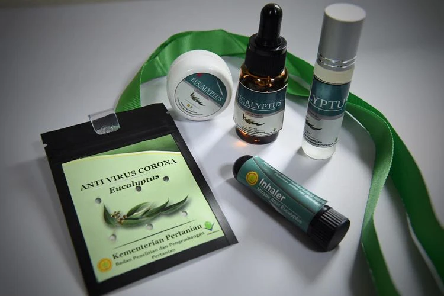
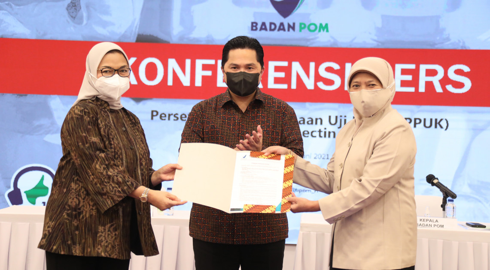
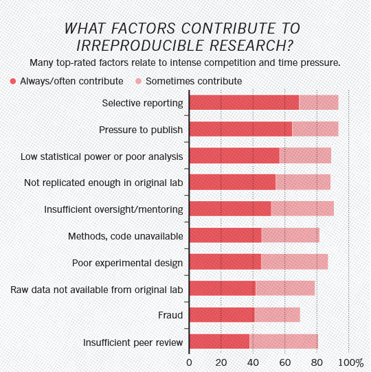
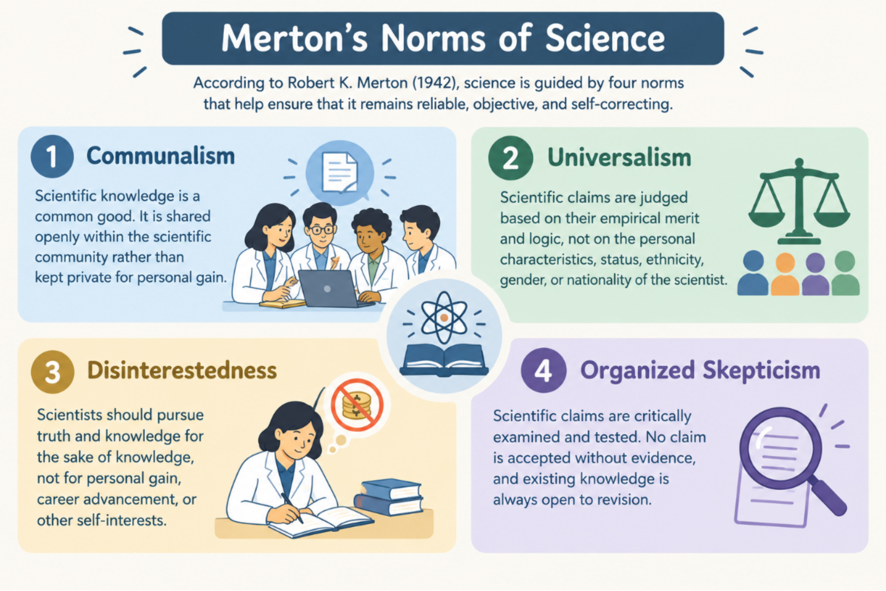
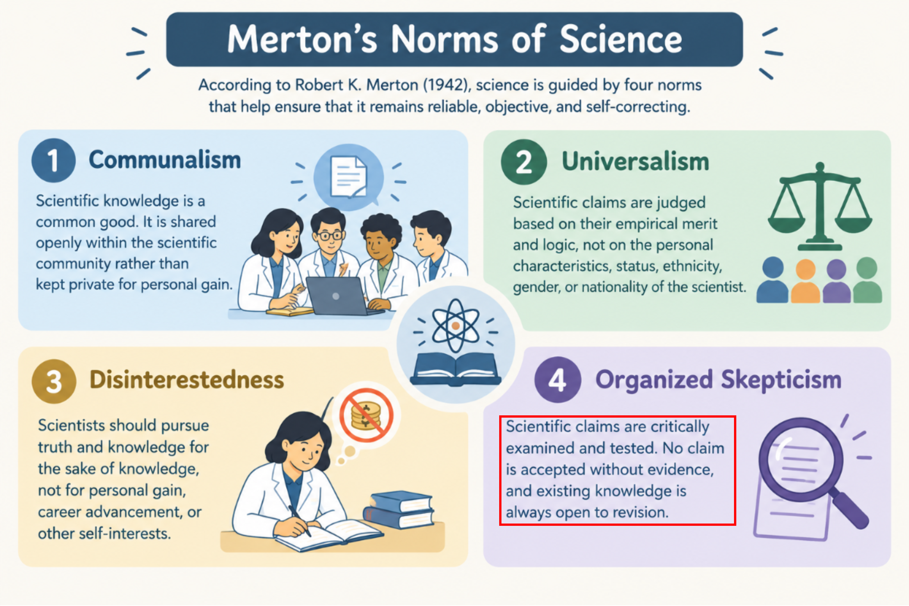
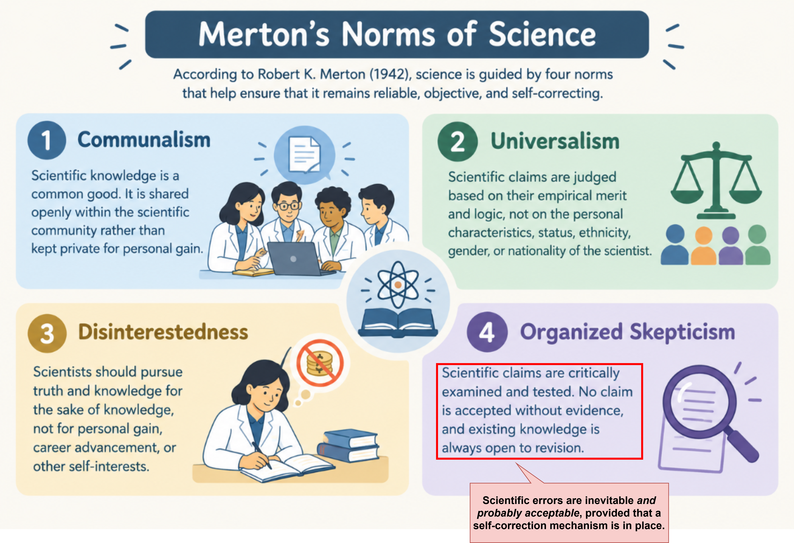
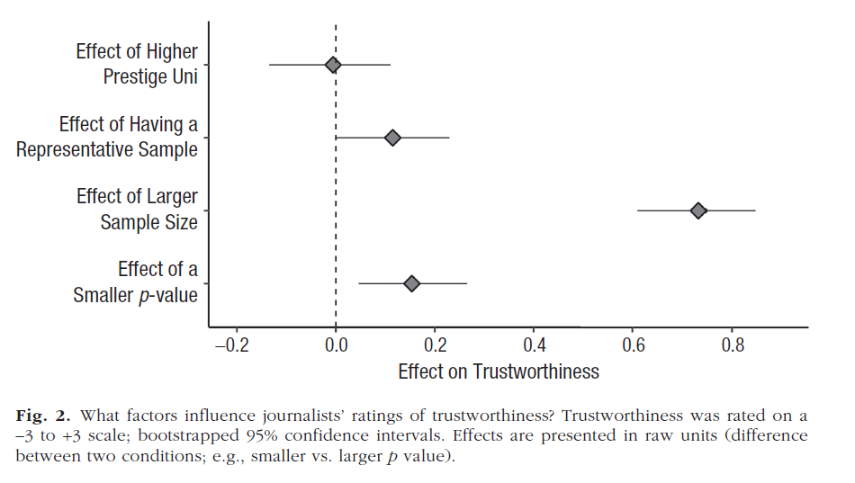
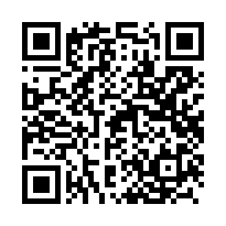

## AGENDA {.agenda-slide}

1. The Replication Crisis: Key Terms, Evidence, and Scope
2. How Metascience Studies the Way Science Corrects Itself
3. A Checklist for Quickly Weighing Scientific Claims
4. Reporting on "Errors" in Science: Helping the Public Calibrate Its Trust

## The "Anti-Corona" Necklace

{fig-align="center"}

::: source
Source: [Universitas Gadjah Mada](https://ugm.ac.id/id/berita/19671-guru-besar-ugm-sebut-kalung-eucalyptus-belum-terbukti-sebagai-anti-covid-19/)
:::

## Ivermectin

{fig-align="center"}

::: source
Source: [Indonesian Food and Drug Authority (BPOM)](https://www.pom.go.id/berita/badan-pom-serahkan-persetujuan-pelaksanaan-uji-klinik-ivermectin)
:::

## Discussion Question {.quote-slide}

::: {.quote-bubble}
> Imagine you are a journalist assigned to cover these two stories. When these claims were circulating, what would you have checked before writing the story? Whom would you have called for confirmation?

::: {.quote-author}
Opening discussion, 5–10 minutes—[Discussion notes are recorded in the working document](https://docs.google.com/document/d/18FzKAZM-D6p4BZOVHOiWzmU52UxBAgoo/edit?usp=sharing&ouid=100126014993390956583&rtpof=true&sd=true)
:::
:::

::: {.notes}
Collect participants' answers as they are and record them in the working document. Bring these answers up again in Section 03, so the checklist feels like a refinement of the workflow they already have.
:::

## Two Cases of "Scientific Error" during the COVID-19 Pandemic {.columns-slide}

::: {.columns-area style="grid-template-columns: repeat(2, 1fr);"}
::: {.col-item}
[<i class="fa-solid fa-leaf"></i>]{.col-icon}

### July 2020: the eucalyptus necklace

The claim from the Ministry of Agriculture's research agency (Balitbang Kementan): the necklace kills the coronavirus, has been "laboratory tested," and is ready for [mass production with PT Eagle Indo Pharma (maker of Cap Lang)](https://ekonomi.bisnis.com/read/20200704/99/1261556/serius-buat-kalung-antivirus-corona-mentan-gandeng-produsen-cap-lang). In fact, [the lab test](https://www.inews.id/news/nasional/balitbangtan-kalung-anticorona-butuh-uji-klinis-izin-edarnyatergolong-jamu) used a different coronavirus model, not SARS-CoV-2. The packaging read "Anti Virus Corona," but its BPOM registration was only as a *jamu* (traditional herbal medicine).
:::

::: {.col-item}
[<i class="fa-solid fa-capsules"></i>]{.col-icon}

### 2021: ivermectin

Promoted by officials and manufacturers as a COVID-19 treatment; the [Minister of State-Owned Enterprises](https://www.cnnindonesia.com/ekonomi/20210621185309-92-657419/erick-thohir-obat-terapi-corona-ivermectin-dapat-izin-bpom) even said it had already been approved for distribution as a COVID-19 drug. [BPOM denied this](https://jabar.antaranews.com/berita/283810/bpom-sebut-data-uji-klinik-ivermectin-untuk-pengobatan-covid-19-belum-tersedia): ivermectin was approved only for parasitic worm infections, and for COVID-19 it was still limited to clinical trials. The manufacturer of Ivermax12 later [apologized](https://kabar24.bisnis.com/read/20210718/15/1419025/produsen-ivermectin-pt-harsen-laboratories-sampaikan-permohonan-maaf-ini-isinya) for its overstated claims, and production was temporarily halted.
:::
:::

::: {.callout-warning appearance="simple" .fragment}
In both cases, the clarification came only **after** the claims had spread widely.
:::

## {.section-slide}

::: {.section-number}
01
:::

::: {.section-bubble}
The Replication Crisis: Terms, Evidence, and Scope
:::

## Let's Start with a Thought Experiment

::: {.lead}
You read an interesting finding in a top journal and imagine turning this scientific article into a news story.
:::

::: {.incremental}

- **Question 1:** If another research team tried *the same study again, collecting new data*, would they find the same result?
- **Question 2:** If another research team reanalyzed *the original data with the original analysis script/files* from that study, would they get exactly the same results as those reported in the article?
- Intuitively, many journalists assume the answer to both is "*yes, of course! This paper was published in a top Q1 journal!*" ([Bottesini et al., 2023](https://journals.sagepub.com/doi/10.1177/25152459231183912))
- Over the past 15 years, researchers have actually checked, and the answer... **has disappointed a lot of people**.

:::

## Three Terms That Often Get Mixed Up {.columns-slide}

::: {.lead}
Based on [Barba (2018)](https://arxiv.org/abs/1802.03311) and [The Turing Way](https://book.the-turing-way.org/), most people tend to confuse these terms:
:::

::: {.columns-area}
::: {.col-item}
[<i class="fa-solid fa-rotate-right"></i>]{.col-icon}

### Reproducibility (🇮🇩 "reka ulang")

**Same data + same analysis → same results.** Other researchers (or the same research team) rerun the same analysis on the same data and get exactly the same results as reported in the article. ***Same recipe and same ingredients, cooked again.***
:::
::: {.col-item}
[<i class="fa-solid fa-people-group"></i>]{.col-icon}

### Replicability (🇮🇩 "coba ulang")

**New data + same method → similar results.** An independent research team repeats the study with new participants and reaches conclusions comparable to the original study. ***Same recipe, cooked with new ingredients.***
:::
::: {.col-item}
[<i class="fa-solid fa-lightbulb"></i>]{.col-icon}

### Robustness (🇮🇩 "keandalan")

**Same data + new analysis → same results, or at least similar conclusions.** The findings stay stable even when different analytic strategies are used. ***The recipe is made with the same ingredients, but with a different cooking technique.***
:::
:::

## Psychology as Ground Zero, 2011

::: {.incremental}
- **2011—Daryl Bem's article on extrasensory perception**: a prestigious journal (*Journal of Personality and Social Psychology*, JPSP) published evidence that people can *sense what will happen in the future* ([Bem, 2011](https://psycnet.apa.org/record/2011-01894-001)), using experimental methods and testing the hypotheses with standard statistical tests, [which sparked controversy](https://www.nytimes.com/2011/01/06/science/06esp.html). If a simple experiment could "prove" the impossible, what is the point of doing research at all?
- [**2011—The Diederik Stapel academic fraud case**](https://www.nytimes.com/2013/04/28/magazine/diederik-stapels-audacious-academic-fraud.html): a once-respected social psychology professor was found to have fabricated data in dozens of published papers.
- **2011—"False-Positive Psychology"** ([Simmons et al., 2011](https://journals.sagepub.com/doi/10.1177/0956797611417632)): showed that analytic choices that seem trivial and routine, but go undisclosed, can make *anything* statistically significant. In this paper, they showed how easy it is to "prove" that listening to the song "*When I'm Sixty-Four*" makes people **literally younger** (by almost 1.5 years, according to their birth dates), an impossible claim.
- These events raised a big question in the psychology community: **how many scientific claims in the psychology literature can actually be trusted?**
:::

::: {.callout-tip appearance="simple" .fragment}
At the time, the psychology community responded most actively (on social media) to the replication crisis, but it was **not the only** discipline with this problem.
:::

## Replication Results

::: {.lead}
How many scientific claims were confirmed when the studies were repeated with new data?
:::

::: {.infographic}
::: {.infographic-cols}
::: {.infographic-item}
[36%]{.stat}

of 100 **psychology** studies ([Open Science Collaboration, 2015](https://www.science.org/doi/10.1126/science.aac4716))
:::
::: {.infographic-item}
[46%]{.stat}

of 112 scientific claims (from 50 experiments published in 23 articles) in **preclinical cancer biology** ([Errington et al., 2021](https://elifesciences.org/articles/71601)). The team originally planned to replicate 193 experiments from 53 high-impact-factor articles (2010–2012), but only 50 experiments from 23 articles could be carried out.
:::
::: {.infographic-item}
[61%]{.stat}

of 18 laboratory experiments in **economics** ([Camerer et al., 2016](https://www.science.org/doi/10.1126/science.aaf0918))
:::
::: {.infographic-item}
[49%]{.stat}

of 164 randomly selected articles (containing 274 claims) replicated with *new* data across **6 disciplines** in the social and behavioral sciences, through the [SCORE project](https://www.cos.io/score). The median effect size in these replications dropped from *r* = 0.25 to 0.10 ([Tyner et al., 2026](https://www.nature.com/articles/s41586-025-10078-y))
:::
:::
:::

::: {.incremental}

- Even when findings were successfully replicated, the average effect size was **only about half** of what was originally reported (known as "[The Decline Effect](https://www.frontiersin.org/journals/psychology/articles/10.3389/fpsyg.2019.02874/full)")—the [SCORE project](https://www.forbes.com/sites/michaeltnietzel/2026/04/04/only-about-half-of-social-science-results-can-be-replicated-finds-new-study/) found the same pattern again in 2026.
- Because this pattern shows up in large-scale research, what the media calls the **"[replication crisis](https://www.nature.com/articles/d41586-026-00955-5)"** does appear to be real.

:::

## What Do Researchers Say?

::: {.lead}
*Nature* surveyed 1,576 researchers across disciplines ([Baker, 2016](https://www.nature.com/articles/533452a.pdf)).
:::

::: {.infographic}
::: {.infographic-cols}
::: {.infographic-item}
[>70%]{.stat}

of researchers in chemistry and biology had failed to replicate another researcher's experiment
:::
::: {.infographic-item}
[>50%]{.stat}

of researchers in chemistry, biology, physics, engineering, and medicine had failed to replicate **their own** experiments
:::
::: {.infographic-item}
[~90%]{.stat}

think there is a replication crisis: 52% said it is a "significant crisis," and 38% a "slight crisis"
:::
:::
:::

::: {.callout-note appearance="simple" .fragment}
Most of the scientists who took part in this survey acknowledge that the replication crisis is real.
:::

## Even Reproducing Results Is Hard

::: {.lead}
Set aside replication, which requires new data. Can scientific claims be reproduced from the original data and materials?
:::

::: {.infographic}
::: {.infographic-cols}
::: {.infographic-item}
[22/67]{.stat}

**economics** articles published in 13 leading journals could be reproduced without contacting the authors ([Chang & Li, 2015](https://www.federalreserve.gov/econresdata/feds/2015/files/2015083pap.pdf))
:::
::: {.infographic-item}
[11/35]{.stat}

articles published in *Cognition*, which requires open data, could be reproduced without help from the original authors ([Hardwicke et al., 2018](https://royalsocietypublishing.org/doi/10.1098/rsos.180448))
:::
::: {.infographic-item}
[1/14]{.stat}

articles with an [open data badge](https://www.cos.io/initiatives/badges) in *Psychological Science* could be reproduced exactly ([Crüwell et al., 2023](https://journals.sagepub.com/doi/10.1177/09567976221140828))
:::
::: {.infographic-item}
[54%]{.stat}

of 143 scientific claims in the social and behavioral sciences could be reproduced exactly from the original data and research materials ([Miske et al., 2026](https://www.nature.com/articles/s41586-026-10203-5))
:::
:::
:::

## A "Seemingly Small" Error with Big Consequences

::: {.incremental}
- [Reinhart and Rogoff](https://www.nber.org/system/files/working_papers/w15639/w15639.pdf) published "*Growth in a Time of Debt*" in 2010.
  + Their conclusion: countries with public debt above 90% of GDP grew much more slowly, at an average of **−0.1%** per year. This conclusion was later cited to justify austerity policies in many countries after the 2008 crisis, especially in the [European Union](https://www.businessinsider.com/austerity-has-damaged-europe-vs-us-gdp-growth-2018-11).
- There was [an error in their Excel file](https://theconversation.com/economists-an-excel-error-and-the-misguided-push-for-austerity-13584), discovered only when a graduate student obtained the original spreadsheet ([Herndon et al., 2014](https://academic.oup.com/cje/article/38/2/257/1714018)).
  + There were three problems: some countries and years of data were selectively excluded; the way countries were weighted was fairly subjective; and a formula error in Excel left some countries out of the average.
  + After correction, average growth for countries with debt above 90% of GDP was about **2.2%**, not −0.1%.
:::

::: {.callout-note appearance="simple" .fragment}
This is not an isolated case—about half of psychology articles are known to contain at least one inconsistently reported statistical result ([Nuijten et al., 2016](https://link.springer.com/article/10.3758/s13428-015-0664-2)).
:::

## Why Did This Crisis Happen?

::: {.lead}
Usually not simply because of bad intent or fraud, but because of a natural human response to the way the incentive system works.
:::

::: {.incremental}
- *Publication bias*: journals tend to publish only novel findings that match theoretical predictions, so null/negative results tend to be rejected.
- *Publish or perish*: academic careers depend on, and are measured by, the number of publications.
- *Questionable research practices* (QRPs): practices in the gray area between justified/valid methodological decisions and data fabrication. These include *p*-hacking, HARKing, and selective reporting ([John et al., 2012](https://journals.sagepub.com/doi/10.1177/0956797611430953)).
- Peer review is not necessarily a guarantee of quality.
  + Reviewers read the manuscript and rarely rerun the analysis.
  + Unpaid, done in between other work, usually by two or three people.
  + Can catch errors that are obvious in the manuscript, but is not designed to catch errors buried in the research cycle.
- Even without bad intent, a single dataset lets researchers take many different sequences of analytic decisions that are all methodologically reasonable ([Gelman & Loken, 2014](http://www.stat.columbia.edu/~gelman/research/unpublished/p_hacking.pdf)).
:::

::: {.notes}
Gelman and Loken call this last point *the garden of forking paths*. In other words, uncertainty is already built into research datasets.
:::

## Why Did This Crisis Happen?

::: {.lead}
What did the 1,576 researchers surveyed by *Nature* say ([Baker, 2016](https://www.nature.com/articles/533452a.pdf))?
:::

{fig-align="center"}

## Discussion Question {.quote-slide}

::: {.quote-bubble}
> Now that you know how much uncertainty, how many problems, and how many errors are built into the way science and scientists work, does science still deserve to be trusted?

::: {.quote-author}
Second discussion, 5–10 minutes—[Discussion notes are recorded in the working document](https://docs.google.com/document/d/18FzKAZM-D6p4BZOVHOiWzmU52UxBAgoo/edit?usp=sharing&ouid=100126014993390956583&rtpof=true&sd=true)
:::
:::

## {.section-slide}

::: {.section-number}
02
:::

::: {.section-bubble}
How Science Corrects Itself
:::

## What Is Metascience?

::: {.lead}
*Research on research*: using the scientific method to check whether [science works the way it should](https://scienceplusplus.org/metascience/#how-does-the-culture-of-science-change).
:::

::: {.incremental}
- How often do scientific claims hold up when other researchers test them again?
- Which practices make scientific claims prone to mistakes/errors?
- How can the biases scientists carry be uncovered, and how can they be addressed?
- How do social processes shape the way science works (e.g., peer review; allocation of resources such as research grants; recruitment, education, and training systems; and the management of research resources)?
:::

## Why Does Metascience Matter?

{fig-align="center" width="65%"}

::: {style="text-align: center; font-size: 0.5em;"}
Source: [Merton (1942)](https://archive.org/details/sociologyofscien0000mert/page/n5/mode/2up). Illustration generated with GPT-6.
:::

## Why Does Metascience Matter?

{fig-align="center"  width="65%"}

::: {style="text-align: center; font-size: 0.5em;"}
Source: [Merton (1942)](https://archive.org/details/sociologyofscien0000mert/page/n5/mode/2up). Illustration generated with GPT-6.
:::

## Why Does Metascience Matter?

{fig-align="center"  width="65%"}

::: {style="text-align: center; font-size: 0.5em;"}
Source: [Merton (1942)](https://archive.org/details/sociologyofscien0000mert/page/n5/mode/2up). Illustration generated with GPT-6.
:::

## What Makes a Recipe Possible to Recreate?

{fig-align="center" width="30%"}

::: {style="text-align: center; font-size: 0.5em;"}
Source: [Devina Hermawan Official Website](https://www.devinahermawan.com/home)
:::

## Open Science Practices through a Cooking Analogy {.columns-slide}

::: {.lead}
When you look up a recipe online, what makes you confident you can recreate the dish?
:::

::: {.columns-area .fragment}
::: {.col-item}
[<i class="fa-solid fa-file-signature"></i>]{.col-icon}

### Preregistration

The recipe is written down and time-stamped **before** cooking: hypotheses, design, analysis plan ([Nosek et al., 2018](https://www.pnas.org/doi/10.1073/pnas.1708274114)).
:::

::: {.col-item}
[<i class="fa-solid fa-folder-open"></i>]{.col-icon}

### Open data and code

The ingredients and their quantities are described in detail and transparently—no "secret recipe"—so others can verify the scientific claims presented in the article.
:::

::: {.col-item}
[<i class="fa-solid fa-clipboard-check"></i>]{.col-icon}

### Registered Reports ([Chambers, 2013](https://orca.cardiff.ac.uk/id/eprint/45177/1/Chambers_Cortex_2013b_GreenOA.pdf))

Reviewers assess the recipe **before** it is cooked. The editor commits to publishing the article whatever the results turn out to be. More than [300 journals across disciplines](https://www.cos.io/initiatives/registered-reports) have adopted this publishing model.
:::
:::

## Do Open Science Practices Have Any Impact? {.columns-slide}

::: {.columns-area}
::: {.col-item}
[<i class="fa-solid fa-clipboard-check"></i>]{.col-icon}

### Registered Reports

::: {style="margin-bottom: 1em;"}
**Impact:** only 44% of RRs report hypotheses supported by the data, compared with 96% of standard articles ([Scheel et al., 2021](https://journals.sagepub.com/doi/10.1177/25152459211007467)). Reviewers judge RRs to be more methodologically rigorous and, overall, to produce higher-quality articles than standard articles ([Soderberg et al., 2021](https://www.nature.com/articles/s41562-021-01142-4)).
:::

**However:** there are still few of them, and not every research design suits this format.
:::

::: {.col-item}
[<i class="fa-solid fa-file-signature"></i>]{.col-icon}

### Preregistration

::: {style="margin-bottom: 1em;"}
**Impact:** preregistered studies more often report statistical power analyses (i.e., the probability of detecting an effect, if that effect truly exists in the population) and have larger sample sizes than non-preregistered studies ([van den Akker et al., 2024](https://link.springer.com/article/10.3758/s13428-023-02277-0)).
:::

**However:** the proportion of positive results and the effect sizes do not differ from standard studies. Of 27 studies in *Psychological Science*, 25 deviated from their preregistration and only one disclosed all of its deviations ([Claesen et al., 2021](https://royalsocietypublishing.org/doi/10.1098/rsos.211037)).
:::

::: {.col-item}
[<i class="fa-solid fa-folder-open"></i>]{.col-icon}

### Open data and code mandates

::: {style="margin-bottom: 1em;"}
**Impact:** 1️⃣ After *Cognition* made open data mandatory, the share of articles with a data availability statement rose from 25% to 78% ([Hardwicke et al., 2018](https://royalsocietypublishing.org/doi/10.1098/rsos.180448)). 2️⃣ At *The BMJ* and *PLOS Medicine*, which require authors to share their data openly, data were available for 17 of 37 eligible clinical trials (published 2013–2016), but only 14 of these could be fully reproduced ([Naudet et al., 2018](https://www.bmj.com/content/360/bmj.k400)). 3️⃣ Of 204 randomly selected articles published in *Science*, which has required open data since 2011, data were actually available for only 44%, and only 26% could be reproduced ([Stodden et al., 2018](https://pubmed.ncbi.nlm.nih.gov/29531050/)).
:::

**However:** shared data and materials cannot necessarily be verified and reproduced.
:::
:::

::: {.callout-note appearance="simple" .fragment}
All three change scientists' behavior, but only to the extent that someone else gets involved and **does the verifying**.
:::

## Limits of Open Science Practices

::: {.incremental}
- Open science practices make errors visible, so they **can be detected** by other scientists.
  + But these practices are not designed to prevent errors committed with bad intent (i.e., academic misconduct, such as data fabrication).
- Open science practices aim to change scientists' behavior at the individual level.
  + Yet systemic causes (e.g., incentives, human resource management, and the scientific publishing system) also contribute substantially.
- These practices push scientists to be more transparent, but transparency only means something if verification also takes place.
  + Ideally, incentives for innovation and for correction would be equal, but in reality, scientists have far less incentive to correct errors than to produce innovations.
  + Efforts to address this have begun (e.g., the [CTRL-Z Award](https://centerforscientificintegrity.org/2026/08/04/2026-winners-ctrl-z-award-courage-retracting-own-work/)), but they are not yet mainstream.
:::

## Case Study: Anomalies in the Data vs. in Article Metadata {.columns-slide}

::: {.columns-area style="grid-template-columns: repeat(2, 1fr);"}
::: {.col-item}
[<i class="fa-solid fa-chart-line"></i>]{.col-icon}

### The Dan Ariely case: anomalies in the data

::: {style="margin-bottom: 1em;"}
**The case:** Study 2 in Ariely and Wertenbroch (2002), *Psychological Science*, on deadlines and procrastination. The data are suspected of having been [fabricated](https://datacolada.org/138).
:::

::: {style="margin-bottom: 1em;"}
**How it was uncovered:** Data Colada compared the original dataset file with data from a failed replication. They found an effect size of *d* = 2.5; 18 of 20 participants in one condition had identical scores (suggesting the data were fabricated by duplicating scores); and time-duration data that were (oddly) too precise, almost never rounded.
:::

**Outcome of the investigation:** both authors have asked for the paper to be retracted (withdrawn from publication); the editor is still processing the request.
:::

::: {.col-item}
[<i class="fa-solid fa-users-viewfinder"></i>]{.col-icon}

### Jaring.id: anomalies in the authorship trail (i.e., scientific article metadata)

::: {style="margin-bottom: 1em;"}
**The case:** fictitious co-authors, foreign researchers' names used without permission, and authorship slots sold by paper mills at a number of Indonesian universities ([Jaring.id et al., 2024](https://jaring.id/main-catut-nama-sampai-daur-ulang-artikel-ilmiah/)). The pattern is systematic, tied to "shortcuts" for getting around academic promotion requirements.
:::

::: {style="margin-bottom: 1em;"}
**How it was uncovered:** investigative journalists traced the [Retraction Watch Database](https://retractiondatabase.org/RetractionSearch.aspx?), [PubPeer](https://pubpeer.com/), Scopus, PDDikti (Indonesia's national higher education database), article-trading groups on social media, and conducted interviews.
:::

**Outcome of the investigation:** ethics sanctions for scientists whose articles were problematic; a new collaboration policy at Universitas Multimedia Nusantara; several journals retracted the problematic articles.
:::
:::

::: {.callout-tip appearance="simple" .fragment}
The first case came to light because **the data were available** to be rechecked, while the second came to light because **the articles' metadata trail** could be traced online.
:::

## Discussion Question {.quote-slide}

::: {.quote-bubble}
> Having read the details of the Dan Ariely case and the Jaring.id investigation, why did it take so much longer to uncover Dan Ariely's (alleged) academic misconduct than that of the Indonesian scientists exposed by Jaring.id?

::: {.quote-author}
Third discussion, 5–10 minutes—[Discussion notes are recorded in the working document](https://docs.google.com/document/d/18FzKAZM-D6p4BZOVHOiWzmU52UxBAgoo/edit?usp=sharing&ouid=100126014993390956583&rtpof=true&sd=true)
:::
:::

## {.section-slide}

::: {.section-number}
03
:::

::: {.section-bubble}
A Checklist for Weighing Scientific Claims
:::

## What Strategies Do Science Journalists Use?

::: {.lead}
[Bottesini et al. (2023)](https://journals.sagepub.com/doi/10.1177/25152459231183912) studied 181 science journalists in an experiment with preregistered hypotheses.
:::

::: {.incremental}
- Participants rated eight summaries of fictional psychology studies.
- Four factors were randomized: sample size, sample representativeness, *p* value, and the prestige of the researchers' university.
- Measured: participants' perception of how trustworthy the study's results were, and how newsworthy they were.
:::

::: {.callout-note appearance="simple" .fragment}
Of these four randomized factors, which one do you think **contributed most** to explaining the journalists' judgments?
:::

## The Results

::: {.lead}
Sample size was the strongest predictor of how trustworthy journalists perceived a scientific claim to be.
:::

{fig-align="center" width="40%"}

::: {style="text-align: center; font-size: 0.5em;"}
Source: [Bottesini et al. (2023)](https://journals.sagepub.com/doi/10.1177/25152459231183912)
:::

::: {.incremental}
- In the open-ended questions, many participants mentioned one verification practice they always follow: **interviewing other experts who were not involved in the study**.
- Other factors mentioned as relevant to journalists' judgments: journal prestige, experimental vs. correlational design, peer review status, funding source, and whether the claims match the evidence.
:::

## Checklist: Four Questions {.columns-slide}

::: {.lead}
Can be applied quickly to a scientific article or a press release that contains a scientific claim.
:::

::: {.columns-area style="grid-template-columns: repeat(2, 1fr);"}
::: {.col-item}
[<i class="fa-solid fa-file-circle-check"></i>]{.col-icon}

### 1. What is the article's status?

Is the scientific article a preprint, already peer-reviewed, or only a press release ([see the difference here](https://www.publisso.de/en/advice/publishing-advice-faqs/preprint-and-postprint))? Do the claims in the press release match the claims in the paper?
:::

::: {.col-item}
[<i class="fa-solid fa-flask"></i>]{.col-icon}

### 2. Is the research well enough executed to support the claim?

Is the design experimental or correlational? Is the sample size proportionate to the size of the claim? Are the data and research materials openly accessible?
:::

::: {.col-item}
[<i class="fa-solid fa-magnifying-glass"></i>]{.col-icon}

### 3. Are there obvious signs of error?

Check for anomalies in the numbers, images, and authorship patterns (more detail on the [next slide](#two-routes-to-detecting-errors)).
:::

::: {.col-item}
[<i class="fa-solid fa-phone"></i>]{.col-icon}

### 4. Has anyone verified it?

Contact an independent expert who was not involved in the study (**a must**) for an initial check. Who funded the study? Has the study ever been replicated?
:::
:::

## Two Routes to Detecting Errors {.columns-slide}

::: {.lead}
The first route requires basic statistical skills, but the second only takes careful attention.
:::

::: {.columns-area style="grid-template-columns: repeat(2, 1fr);"}
::: {.col-item}
[<i class="fa-solid fa-chart-column"></i>]{.col-icon}

### The statistical route

::: {style="margin-bottom: 1em;"}
✅ Are the reported *p* values very close to 0.05?
:::

::: {style="margin-bottom: 1em;"}
✅ Is the reported effect size plausible, or too large compared with similar studies in the field (Ariely's Study 2: *d* = 2.5, far too large for a typical psychology study)?
:::

✅ Are there duplicated/identical or suspiciously tidy data in the data table (Ariely's Study 2: 18 of 20 participants had identical/duplicated data)?
:::

::: {.col-item}
[<i class="fa-solid fa-file-lines"></i>]{.col-icon}

### The metadata route

::: {style="margin-bottom: 1em;"}
✅ Is there anything odd about the text and images in the article? For example, [duplicated images](https://retractionwatch.com/2026/04/19/elisabeth-bik-scientific-sleuth-image-duplication-mbio-biorxiv-preprint/), [tortured phrases](https://www.nature.com/articles/d41586-021-02134-0), [undeclared AI use](https://academ-ai.info/), fictitious references
:::

::: {style="margin-bottom: 1em;"}
✅ [Does the research team's collaboration pattern make sense](https://theconversation.com/mengenal-cara-kerja-paper-mill-pabrik-artikel-ilmiah-yang-beroperasi-seperti-kartel-di-film-film-228784)? If something seems off, this is usually a hallmark of paper-mill articles.
:::

::: {style="margin-bottom: 1em;"}
✅ Do the authors or the journal have a history of retractions in [open databases](#tools-you-can-use)?
:::

✅ If there is a history of retractions, what were the causes/reasons for them?
:::
:::

## Tools You Can Use {.text-slide-bg}

::: {.content-box}
- [**Retraction Watch Database**](https://retractiondatabase.org): to check the retraction history of authors or journals.
- [**PubPeer**](https://pubpeer.com): for post-publication peer review by other researchers, often used to report errors in published articles.
- [**statcheck**](https://statcheck.io): to check the consistency of reported statistical results.
- [**ImageTwin**](https://imagetwin.ai/): to check for image duplication and manipulation in research articles.
- [**Citely**](https://citely.ai): a platform for checking the authenticity of cited references.

:::

## Journal Prestige Is No Guarantee

::: {.lead}
Journalists in the [Bottesini et al. (2023)](https://journals.sagepub.com/doi/10.1177/25152459231183912) study did not see university prestige as a factor in their judgments, but some mentioned that the **prestige of the journal** publishing the article could be relied on.
:::

::: {.incremental}
- The higher a journal's impact factor, the more often its articles are retracted ([Fang & Casadevall, 2011](https://journals.asm.org/doi/10.1128/iai.05661-11)).
- Of 21 social science experiments published in *Nature* and *Science*, only 13 were successfully replicated, with an average effect size about half the original ([Camerer et al., 2018](https://www.nature.com/articles/s41562-018-0399-z)).
  + And yet *Nature* and *Science* are the two most prestigious journals among scientists.
- The impact factor and journal quartile (Q1–Q4) measure how often articles in the **journal** are cited on average, not the quality of the **articles** it publishes.
  + Citations are also usually propped up by a small number of very highly cited articles ([Seglen, 1997](https://doi.org/10.1136/bmj.314.7079.497)).
- Dan Ariely's article was published in *Psychological Science*, considered highly prestigious among psychologists; some of the paper-mill articles exposed by Jaring.id were published in Scopus-indexed journals, considered prestigious among Indonesian scientists.
- For this reason, some scientists argue that using journal prestige as an indicator of research quality is a form of bad scientific practice ([Brembs et al., 2013](https://www.frontiersin.org/journals/human-neuroscience/articles/10.3389/fnhum.2013.00291/full)).
:::

## {.section-slide}

::: {.section-number}
04
:::

::: {.section-bubble}
Reporting on "Errors" in Science: Helping the Public Calibrate Its Trust
:::

## Why Science Journalists (and Communicators) Matter

::: {.lead}
[Schapals et al. (2026)](https://doi.org/10.17645/mac.12392) map the various actors who "watch over" science as watchdogs, from investigative science journalists to [scientific sleuths](https://sciencewatchdog.id/2025/10/18/the-rise-of-scientific-sleuths-ensuring-research-integrity/) on [PubPeer](https://pubpeer.com/). They fill many important roles that scientists cannot.
:::

::: {.incremental}
- Drawing public attention and speeding up the correction of the scientific literature.
  + [Brian Deer's investigation in the *Sunday Times*](http://archive.today/2025.09.24-144220/https://www.thetimes.com/culture/books/article/andrew-wakefield-interview-mmr-autism-vaccine-brian-deer-b3ftnwmfz) in 2009 contributed to *The Lancet*'s retraction of Andrew Wakefield's article (which claimed a link between the MMR vaccine and autism) in 2010.
  + [Dyna Rochmyaningsih's investigation](https://www.sciencemagazinedigital.org/sciencemagazine/27_july_2018/MobilePagedArticle.action?articleId=1412604), published in *Science* in 2018, into the ethical problems of [research conducted with the Bajau people](https://www.science.org/content/article/indonesian-divers-have-evolved-bigger-spleens-hunt-underwater), sparked discussion about administrative procedural certainty and epistemic justice in research carried out by foreign researchers involving Indigenous communities. [Law No. 11/2019 on the National System of Science and Technology (Sisnas Iptek)](https://peraturan.bpk.go.id/Details/117023/uu-no-11-tahun-2019) was passed a year later.
  + [Catherine Offord's reporting](https://www.the-scientist.com/tag/surgisphere) (*The Scientist*) and [an investigation by *The Guardian*](https://www.theguardian.com/world/2020/jun/03/covid-19-surgisphere-who-world-health-organization-hydroxychloroquine) exposed the Surgisphere data scandal. The *Lancet* article that used these data reported that hydroxychloroquine was associated with an **increased** risk of death among COVID-19 patients, and briefly led the WHO to pause its clinical trial. The article was [retracted by *The Lancet*](https://doi.org/10.1016/S0140-6736(20)31324-6) on June 4, 2020.

:::

## Other Roles of Science Journalists (and Communicators)

::: {.lead}
[Schapals et al. (2026)](https://doi.org/10.17645/mac.12392) map the various actors who "watch over" science as watchdogs, from investigative science journalists to [scientific sleuths](https://sciencewatchdog.id/2025/10/18/the-rise-of-scientific-sleuths-ensuring-research-integrity/) on [PubPeer](https://pubpeer.com/). They fill many important roles that scientists cannot.
:::

::: {.incremental}

- Translating the implications of technical errors for the public: platforms such as [PubPeer](https://pubpeer.com/), [statcheck](https://statcheck.io/), and [ImageTwin](https://imagetwin.ai/) detect and document problems and errors, but they are understood only within a limited circle of scientists.
- Science journalists have legal protection and social infrastructure that individual scientific sleuths or whistleblowers lack.
- Separating evidence-based criticism from anti-science actors who also claim to be "exposing" scientists' lies.
- Filling gaps in countries with weak research integrity infrastructure: [Plagio SOS](https://pluralidadz.com/author/plagiosos/) in Latin America, [India Research Watch](https://irw.co.in/), [Selisik Integritas Akademik](https://theconversation.com/topics/selisik-integritas-akademis-155172) (a collaboration of Jaring.id, Tempo, and The Conversation Indonesia) and [ScienceWatchdog](https://sciencewatchdog.id/) in Indonesia.
:::

## Risks to Mitigate

::: {.lead}
The goal of reporting: readers trust scientific claims in proportion to the strength of the evidence.
:::

::: {.incremental}
- Risk 1️⃣: Overtrust
  + Weak scientific claims reported sensationally, like the eucalyptus necklace and ivermectin.
- Risk 2️⃣: Spreading distrust
  + Readers' perceptions leap from "one case of error/misconduct" to "none of science can be trusted."
:::

::: {.callout-note appearance="simple" .fragment}
Exposing errors/misconduct in science is essential, given that **public funding**, **policies**, and **clinical decisions**, which can have far-reaching effects on society, are generally justified by scientific claims. But the question is: how can both of the risks above be minimized?
:::

::: {.notes}
If a scientific claim really does rest on weak evidence, a drop in public trust in that specific finding is exactly the outcome a story should hope for. What needs to be prevented is a loss of trust that spills over into science in general.
:::

## Is It Newsworthy?

::: {.lead}
Not every case of error/misconduct/retraction deserves a story. [Pawar (2022)](https://www.theopennotebook.com/2022/05/31/reporting-on-retractions/) summarizes four questions journalists commonly ask to determine news value.
:::

::: {.incremental}
- ✅ Does the case have wider implications? These include implications for research in the field, clinical or medical applications, or policy implications
- ✅ Does the case reveal something about how science works?
- ✅ Are the people involved in the case highly influential, or do they hold positions of authority?
- ✅ Is the case unusual or egregious enough that it has to be reported?
:::

## Aim Criticism at the Right Target {.columns-slide}

::: {.lead}
The party in the wrong is always a specific one: a researcher, an institution, a journal, or a policy. Not "science in general."
:::

::: {.columns-area style="grid-template-columns: repeat(2, 1fr);"}
::: {.col-item}
[<i class="fa-solid fa-xmark"></i>]{.col-icon}

### Avoid

- "Research shows…"
- "Scientists turn out to be wrong"
- "Our academic world is rotten"
:::

::: {.col-item}
[<i class="fa-solid fa-check"></i>]{.col-icon}

### Consider

- "Ariely and Wertenbroch's (2002) study in *Psychological Science* shows…"
- "Study 2's data are suspected of being fabricated; the journal is processing its retraction"
- "Scopus publication requirements for academic promotion are driving the trade in authorship slots"
:::
:::

::: {.callout-note appearance="simple" .fragment}
Naming the specific parties, such as researchers, institutions, journals, and policies, makes it clear **where the error lies** and **who should be held accountable**.
:::

## Reporting Errors Can Be Framed as a Self-Correction Mechanism

::: {.incremental}
- An article retraction indicates that there was a verification process, that a problem was identified, and that this self-correcting system responded.
  + But the system's response is indeed **often slow**: Andrew Wakefield's article was published in 1998, but [was not fully retracted by *The Lancet* until 2010](https://www.bmj.com/content/342/bmj.c7001.long).
- Few retractions in a field is not necessarily good news: the errors may still be there, but no one is checking for them and finding them.
- Should the independent experts/parties who found/verified the error be named in the story?
  + Name the checkers/verifiers only with their consent, since some prefer to work anonymously because their job position/status tends to be precarious.
:::

::: {.notes}
According to [Fanelli (2013)](https://doi.org/10.1371/journal.pmed.1001563), the rising number of retractions more likely reflects better detection than more misconduct. But self-correction does not happen on its own. [Vazire and Holcombe (2022)](https://doi.org/10.1177/10892680211033912) suggest looking at observable signs, such as transparency in the research and peer review process and active efforts to detect errors.

Articles that receive a lot of attention and are later retracted generally get more coverage when they are published than when their retraction is announced ([Serghiou et al., 2021](https://doi.org/10.1371/journal.pone.0248625)). Reporting on retractions can close this gap.

:::

## Use Precise Language {.text-slide-bg}

::: {.lead}
These five types of cases need to be distinguished and described explicitly, so that the story stays proportionate.
:::

::: {.content-box}
- **Data fabrication/falsification**: data deliberately invented or manipulated with bad intent, but such cases are relatively rare.
- **Publication misconduct**: buying and selling authorship slots, paper mills, fictitious authors, plagiarism, duplicate publication by authors; in Indonesia, these cases are fairly common, and are usually driven by the motivation to [take shortcuts](https://theconversation.com/efek-kobra-dosen-indonesia-terobsesi-pada-indeks-scopus-dan-praktik-tercela-menuju-universitas-kelas-dunia-105808) to obtain incentives.
- **Questionable research practices (QRPs)**: methodological shortcuts in a gray area, possibly without bad intent.
- **Honest error**: typos, procedural mistakes, miscalculations; can happen even to very careful researchers.
- **Retraction without any indication of academic misconduct**: an article published twice because of a publisher's mistake, problems with the article's metadata.

When in doubt, ask the journal's editorial office: what is the official reason for the retraction, and who requested it?
:::

::: {.notes}
The official terms in [Permendikbudristek 39/2021](https://www.peraturan.go.id/files/bn1363-2021.pdf) (Indonesian Ministerial Regulation No. 39/2021), Article 9: fabrication, falsification, plagiarism, unauthorized authorship, conflict of interest, and multiple submission. Use these terms when writing about cases at Indonesian universities.

Note that data from [Fang et al. (2012)](https://doi.org/10.1073/pnas.1212247109) show that 67.4% of retractions in biomedicine were linked to academic misconduct, and only about one fifth to honest error. Always check the reason for retraction in each case.
:::

## Always Report the Denominator

::: {.lead}
"*More than 10,000 scientific articles were retracted in 2023, the highest on record*" sounds alarming. But out of how many published articles, and where did they come from?
:::

::: {.infographic}
::: {.infographic-cols}
::: {.infographic-item}
[0.2%]{.stat}

of articles published in 2022 were eventually retracted, or about 1 in 500
:::
::: {.infographic-item}
[8,000+]{.stat}

of those 10,000 retractions came from a single publisher (Hindawi), most of them from special issues
:::
:::
:::

::: source
Source: [Van Noorden (2023)](https://doi.org/10.1038/d41586-023-03974-8), *Nature, 624*, 479–481.
:::

::: {.notes}

The 0.2% figure makes the "10,000 record" less alarming than it sounds, but the retraction rate also more than tripled in a decade, faster than the growth in the number of articles. Sleuths say the 50,000 recorded retractions are only the tip of the iceberg; paper-mill output is estimated in the hundreds of thousands.

Comparisons between countries also need a denominator: among countries with more than 100,000 articles over two decades, the highest retraction rates are in Saudi Arabia (30.6 per 10,000 articles), Pakistan (28.1), Russia, and China. Malaysia stands at 17.2.
:::

## Before Publication {.text-slide-bg}

::: {.lead}
Practices summarized by [Pawar (2022)](https://www.theopennotebook.com/2022/05/31/reporting-on-retractions/) from the experience of journalists [Charles Piller](https://charlespiller.com/) and [Richard Van Noorden](https://muckrack.com/richvn):
:::

::: {.content-box}
- Send all your findings to the party under investigation in a single email, e.g., as a [no-surprise email](https://www.theopennotebook.com/2018/12/11/how-to-conduct-difficult-interviews/).
- Give them enough time to respond.
- Make clear that not responding will not stop publication.
- Always verify sources' claims independently, including sources whose identity you are protecting.
:::

## Round It Out with Accountability {.columns-slide}

::: {.lead}
A story that stops at describing the scandal risks breeding public cynicism. Reduce this risk by rounding out the story with information about what has changed, or what should be done but has not been done yet.
:::

::: {.columns-area style="grid-template-columns: repeat(2, 1fr);"}
::: {.col-item}
[<i class="fa-solid fa-xmark"></i>]{.col-icon}

### Avoid

- Stopping at "the article is suspected to be a paper-mill product"
- "This case tarnishes the reputation of Indonesian researchers"
:::

::: {.col-item}
[<i class="fa-solid fa-check"></i>]{.col-icon}

### Consider

- "The university imposed ethics sanctions and introduced new rules for international collaboration"
- "Frontiers retracted four articles by two authors highlighted in this report"
- "The editors of *Psychological Science* are still processing the retraction"
:::
:::

::: {.callout-note appearance="simple" .fragment}
The question "so what did the institution do?" is often the most important part of the story. Try to chase down this information and include it as a key part of the story. But even if no action has been taken at all, that is still worth reporting, so that there is public pressure for, and support of, the changes/actions that need to happen.
:::

## Three Toolkits to Take Away {.columns-slide}

::: {.columns-area}
::: {.col-item}
[<i class="fa-solid fa-clock"></i>]{.col-icon}

### A quick check of newsworthiness and claim quality

Use the checklist before deciding to cover a research finding.
:::

::: {.col-item}
[<i class="fa-solid fa-user-check"></i>]{.col-icon}

### *Trust, but verify* ([Van Noorden, in Pawar, 2022](https://www.theopennotebook.com/2022/05/31/reporting-on-retractions/))

Always cross-check by interviewing independent experts for every story.
:::

::: {.col-item}
[<i class="fa-solid fa-scale-balanced"></i>]{.col-icon}

### Name the verifiers

Always name who found the problem (if they agree to be named), so readers know where the correction came from.
:::
:::

## Conclusion

::: {.lead}
Science is not free of errors. What makes it trustworthy is that **there are procedures and systems** to **check** and **correct** them.
:::

::: {.incremental}
1. **The replication crisis is real.** Many findings, including those published in top journals, do not hold up when replicated. Some cannot even be reproduced from the original data.
2. **Open science helps, but it has limits.** Preregistration, Registered Reports, and open data change researchers' behavior to the extent that someone checks. But none of them stops academic misconduct committed with bad intent.
3. **Prestige is not a measure of quality.** Check the article's publication status, its design and sample size, and any signs of error, and ask independent experts for their opinion.
4. **Report errors proportionately.** Aim criticism at the right target, use the right terms, include the denominator, and close with what action was taken or what policy changed.
:::

## Please Help by Filling Out the Evaluation Survey

::: {.lead}
Please take ~5 minutes to evaluate the material presented today. The survey is anonymous; no personal information is requested. Thank you very much for your help!😊
:::

::: {style="text-align: center; font-size: 2em;"}
[Click here](https://www.soscisurvey.de/fb-workshop-amel/) or scan the QR code below.
:::

{fig-align="center"}

## References {.text-slide-bg .scrollable}

::: {.lead}
This reference page can be scrolled down.
:::

::: {.content-box style="font-size: 0.5em;"}
**Scientific articles and research reports**

- Baker, M. (2016). [1,500 scientists lift the lid on reproducibility](https://doi.org/10.1038/533452a). *Nature, 533*(7604), 452–454.
- Barba, L. A. (2018). [Terminologies for reproducible research](https://arxiv.org/abs/1802.03311). *arXiv*, 1802.03311.
- Bem, D. J. (2011). [Feeling the future: Experimental evidence for anomalous retroactive influences on cognition and affect](https://doi.org/10.1037/a0021524). *Journal of Personality and Social Psychology, 100*(3), 407–425.
- Bottesini, J. G., Aschwanden, C., Rhemtulla, M., & Vazire, S. (2023). [How do science journalists evaluate psychology research?](https://doi.org/10.1177/25152459231183912) *Advances in Methods and Practices in Psychological Science, 6*(3), 25152459231183912.
- Brembs, B., Button, K., & Munafò, M. (2013). [Deep impact: Unintended consequences of journal rank](https://doi.org/10.3389/fnhum.2013.00291). *Frontiers in Human Neuroscience, 7*, 291.
- Camerer, C. F., et al. (2016). [Evaluating replicability of laboratory experiments in economics](https://doi.org/10.1126/science.aaf0918). *Science, 351*(6280), 1433–1436.
- Camerer, C. F., et al. (2018). [Evaluating the replicability of social science experiments in *Nature* and *Science* between 2010 and 2015](https://doi.org/10.1038/s41562-018-0399-z). *Nature Human Behaviour, 2*(9), 637–644.
- Chambers, C. D. (2013). [Registered Reports: A new publishing initiative at *Cortex*](https://doi.org/10.1016/j.cortex.2012.12.016). *Cortex, 49*(3), 609–610.
- Chang, A. C., & Li, P. (2015). [Is economics research replicable? Sixty published papers from thirteen journals say "usually not"](https://doi.org/10.17016/FEDS.2015.083). *Finance and Economics Discussion Series*, 2015-083. Federal Reserve Board.
- Claesen, A., Gomes, S., Tuerlinckx, F., & Vanpaemel, W. (2021). [Comparing dream to reality: An assessment of adherence of the first generation of preregistered studies](https://doi.org/10.1098/rsos.211037). *Royal Society Open Science, 8*(10), 211037.
- Crüwell, S., et al. (2023). [What's in a badge? A computational reproducibility investigation of the open data badge policy in one issue of *Psychological Science*](https://doi.org/10.1177/09567976221140828). *Psychological Science, 34*(4), 512–522.
- Errington, T. M., et al. (2021). [Investigating the replicability of preclinical cancer biology](https://doi.org/10.7554/eLife.71601). *eLife, 10*, e71601.
- Fanelli, D. (2013). [Why growing retractions are (mostly) a good sign](https://doi.org/10.1371/journal.pmed.1001563). *PLoS Medicine, 10*(12), e1001563.
- Fang, F. C., & Casadevall, A. (2011). [Retracted science and the retraction index](https://doi.org/10.1128/IAI.05661-11). *Infection and Immunity, 79*(10), 3855–3859.
- Fang, F. C., Steen, R. G., & Casadevall, A. (2012). [Misconduct accounts for the majority of retracted scientific publications](https://doi.org/10.1073/pnas.1212247109). *PNAS, 109*(42), 17028–17033.
- Gelman, A., & Loken, E. (2014). [The garden of forking paths](http://www.stat.columbia.edu/~gelman/research/unpublished/p_hacking.pdf) [Unpublished manuscript]. Columbia University.
- Hardwicke, T. E., et al. (2018). [Data availability, reusability, and analytic reproducibility: Evaluating the impact of a mandatory open data policy at the journal *Cognition*](https://doi.org/10.1098/rsos.180448). *Royal Society Open Science, 5*(8), 180448.
- Herndon, T., Ash, M., & Pollin, R. (2014). [Does high public debt consistently stifle economic growth? A critique of Reinhart and Rogoff](https://doi.org/10.1093/cje/bet075). *Cambridge Journal of Economics, 38*(2), 257–279.
- John, L. K., Loewenstein, G., & Prelec, D. (2012). [Measuring the prevalence of questionable research practices with incentives for truth telling](https://doi.org/10.1177/0956797611430953). *Psychological Science, 23*(5), 524–532.
- Merton, R. K. (1973). [The normative structure of science](https://archive.org/details/sociologyofscien0000mert/page/n5/mode/2up). In N. W. Storer (Ed.), *The sociology of science: Theoretical and empirical investigations* (pp. 267–278). University of Chicago Press. (Original work published 1942)
- Miske, O., et al. (2026). [Investigating the reproducibility of the social and behavioural sciences](https://doi.org/10.1038/s41586-026-10203-5). *Nature, 652*(8108), 126–134.
- Naudet, F., et al. (2018). [Data sharing and reanalysis of randomized controlled trials in leading biomedical journals with a full data sharing policy: Survey of studies published in *The BMJ* and *PLOS Medicine*](https://doi.org/10.1136/bmj.k400). *BMJ, 360*, k400.
- Nielsen, M., & Qiu, K. (2022). [A vision of metascience: An engine of improvement for the social processes of science](https://scienceplusplus.org/metascience/). Science++.
- Nosek, B. A., Ebersole, C. R., DeHaven, A. C., & Mellor, D. T. (2018). [The preregistration revolution](https://doi.org/10.1073/pnas.1708274114). *PNAS, 115*(11), 2600–2606.
- Nuijten, M. B., Hartgerink, C. H. J., van Assen, M. A. L. M., Epskamp, S., & Wicherts, J. M. (2016). [The prevalence of statistical reporting errors in psychology (1985–2013)](https://doi.org/10.3758/s13428-015-0664-2). *Behavior Research Methods, 48*(4), 1205–1226.
- Open Science Collaboration. (2015). [Estimating the reproducibility of psychological science](https://doi.org/10.1126/science.aac4716). *Science, 349*(6251), aac4716.
- Pietschnig, J., Siegel, M., Eder, J. S. N., & Gittler, G. (2019). [Effect declines are systematic, strong, and ubiquitous: A meta-meta-analysis of the decline effect in intelligence research](https://doi.org/10.3389/fpsyg.2019.02874). *Frontiers in Psychology, 10*, 2874.
- Reinhart, C. M., & Rogoff, K. S. (2010). [Growth in a time of debt](https://doi.org/10.3386/w15639) (NBER Working Paper No. 15639). National Bureau of Economic Research.
- Schapals, A. K., Riedlinger, M., Montaña-Niño, S., & Rednikin, A. (2026). [Shining light on "dark science": Mapping the field of science watchdog journalism](https://doi.org/10.17645/mac.12392). *Media and Communication, 14*, 12392.
- Scheel, A. M., Schijen, M. R. M. J., & Lakens, D. (2021). [An excess of positive results: Comparing the standard psychology literature with Registered Reports](https://doi.org/10.1177/25152459211007467). *Advances in Methods and Practices in Psychological Science, 4*(2), 25152459211007467.
- Seglen, P. O. (1997). [Why the impact factor of journals should not be used for evaluating research](https://doi.org/10.1136/bmj.314.7079.497). *BMJ, 314*(7079), 497.
- Serghiou, S., Marton, R. M., & Ioannidis, J. P. A. (2021). [Media and social media attention to retracted articles according to Altmetric](https://doi.org/10.1371/journal.pone.0248625). *PLOS ONE, 16*(5), e0248625.
- Simmons, J. P., Nelson, L. D., & Simonsohn, U. (2011). [False-positive psychology: Undisclosed flexibility in data collection and analysis allows presenting anything as significant](https://doi.org/10.1177/0956797611417632). *Psychological Science, 22*(11), 1359–1366.
- Soderberg, C. K., et al. (2021). [Initial evidence of research quality of registered reports compared with the standard publishing model](https://doi.org/10.1038/s41562-021-01142-4). *Nature Human Behaviour, 5*(8), 990–997.
- Stodden, V., Seiler, J., & Ma, Z. (2018). [An empirical analysis of journal policy effectiveness for computational reproducibility](https://doi.org/10.1073/pnas.1708290115). *PNAS, 115*(11), 2584–2589.
- Tyner, A. H., et al. (2026). [Investigating the replicability of the social and behavioural sciences](https://doi.org/10.1038/s41586-025-10078-y). *Nature, 652*(8108), 143–150.
- van den Akker, O. R., et al. (2024). [Preregistration in practice: A comparison of preregistered and non-preregistered studies in psychology](https://doi.org/10.3758/s13428-023-02277-0). *Behavior Research Methods, 56*(6), 5424–5433.
- Vazire, S., & Holcombe, A. O. (2022). [Where are the self-correcting mechanisms in science?](https://doi.org/10.1177/10892680211033912) *Review of General Psychology, 26*(2), 212–223.

**Investigations, news, and online sources**

- Bhattacharjee, Y. (2013, April 26). [The mind of a con man](https://www.nytimes.com/2013/04/28/magazine/diederik-stapels-audacious-academic-fraud.html). *The New York Times Magazine*.
- Center for Open Science. (2026). [Large-scale collaboration releases new findings on research credibility](https://www.cos.io/about/news/large-scale-collaboration-releases-new-findings-on-research-credibility) [SCORE press release].
- The Center for Scientific Integrity. (2026, August 4). [2026 winners of the CTRL-Z Award for courage in retracting one's own work](https://centerforscientificintegrity.org/2026/08/04/2026-winners-ctrl-z-award-courage-retracting-own-work/).
- Data Colada. (2026, August 31). [[138] Artificial deadlines (part 1): Evidence of fraud in an influential study about procrastination](https://datacolada.org/138).
- Davey, M., Kirchgaessner, S., & Boseley, S. (2020, June 3). [Surgisphere: Governments and WHO changed Covid-19 policy based on suspect data from tiny US company](https://www.theguardian.com/world/2020/jun/03/covid-19-surgisphere-who-world-health-organization-hydroxychloroquine). *The Guardian*.
- Else, H. (2021). ['Tortured phrases' give away fabricated research papers](https://doi.org/10.1038/d41586-021-02134-0). *Nature, 596*(7872), 328–329.
- Jones, N. (2026). [Half of social-science studies fail replication test in years-long project](https://doi.org/10.1038/d41586-026-00955-5). *Nature*.
- Mehra, M. R., Ruschitzka, F., & Patel, A. N. (2020). [Retraction—Hydroxychloroquine or chloroquine with or without a macrolide for treatment of COVID-19: A multinational registry analysis](https://doi.org/10.1016/S0140-6736(20)31324-6). *The Lancet, 395*(10240), 1820.
- Pawar, P. (2022, May 31). [Reporting on retractions](https://www.theopennotebook.com/2022/05/31/reporting-on-retractions/). *The Open Notebook*.
- Pickett, M. (2018, December 11). [How to conduct difficult interviews](https://www.theopennotebook.com/2018/12/11/how-to-conduct-difficult-interviews/). *The Open Notebook*.
- Rochmyaningsih, D. (2018, July 27). [Did a study of Indonesian people who spend most of their days under water violate ethical rules?](https://www.sciencemagazinedigital.org/sciencemagazine/27_july_2018/MobilePagedArticle.action?articleId=1412604) *Science*.
- ScienceWatchdog.id. (2025, October 18). [The rise of scientific sleuths: Ensuring research integrity](https://sciencewatchdog.id/2025/10/18/the-rise-of-scientific-sleuths-ensuring-research-integrity/).
- Somad, A., et al. (2024, April 22). [Main catut nama sampai daur ulang artikel ilmiah](https://jaring.id/main-catut-nama-sampai-daur-ulang-artikel-ilmiah/) \[From misused names to recycled scientific articles\]. *Jaring.id*, in collaboration with *Tempo* and *The Conversation Indonesia*.
- Van Noorden, R. (2023). [More than 10,000 research papers were retracted in 2023 — a new record](https://doi.org/10.1038/d41586-023-03974-8). *Nature, 624*(7992), 479–481.
- Zein, R. A. (2018, November 16). [Efek kobra, dosen Indonesia terobsesi pada indeks Scopus dan praktik tercela menuju universitas kelas dunia](https://theconversation.com/efek-kobra-dosen-indonesia-terobsesi-pada-indeks-scopus-dan-praktik-tercela-menuju-universitas-kelas-dunia-105808) \[The cobra effect: Indonesian lecturers' obsession with Scopus indexing and disgraceful practices on the road to world-class universities\]. *The Conversation Indonesia*.
- Zein, R. A. (2024, May 15). [Mengenal cara kerja 'paper mill': Pabrik artikel ilmiah yang beroperasi seperti kartel di film-film](https://theconversation.com/mengenal-cara-kerja-paper-mill-pabrik-artikel-ilmiah-yang-beroperasi-seperti-kartel-di-film-film-228784) \[How 'paper mills' work: Scientific article factories that operate like cartels in the movies\]. *The Conversation Indonesia*.
- Wakefield and Surgisphere cases: [Brian Deer interview in *The Times*](http://archive.today/2025.09.24-144220/https://www.thetimes.com/culture/books/article/andrew-wakefield-interview-mmr-autism-vaccine-brian-deer-b3ftnwmfz) (archived); [Catherine Offord's coverage in *The Scientist*](https://www.the-scientist.com/tag/surgisphere); [*ABC News* timeline](https://abcnews.com/Health/timeline-tracking-trump-alongside-scientific-developments-hydroxychloroquine/story?id=72170553) on hydroxychloroquine
- Reinhart and Rogoff case: [*The Conversation* (2013)](https://theconversation.com/economists-an-excel-error-and-the-misguided-push-for-austerity-13584); [*Business Insider* (2018)](https://www.businessinsider.com/austerity-has-damaged-europe-vs-us-gdp-growth-2018-11)
- Eucalyptus necklace case: [UGM](https://ugm.ac.id/id/berita/19671-guru-besar-ugm-sebut-kalung-eucalyptus-belum-terbukti-sebagai-anti-covid-19/); [*Bisnis.com* (2020)](https://ekonomi.bisnis.com/read/20200704/99/1261556/serius-buat-kalung-antivirus-corona-mentan-gandeng-produsen-cap-lang); [*iNews*](https://www.inews.id/news/nasional/balitbangtan-kalung-anticorona-butuh-uji-klinis-izin-edarnyatergolong-jamu)
- Ivermectin case: [BPOM](https://www.pom.go.id/berita/badan-pom-serahkan-persetujuan-pelaksanaan-uji-klinik-ivermectin); [*CNN Indonesia* (2021)](https://www.cnnindonesia.com/ekonomi/20210621185309-92-657419/erick-thohir-obat-terapi-corona-ivermectin-dapat-izin-bpom); [*Antara Jabar*](https://jabar.antaranews.com/berita/283810/bpom-sebut-data-uji-klinik-ivermectin-untuk-pengobatan-covid-19-belum-tersedia); [*Kabar24* (2021)](https://kabar24.bisnis.com/read/20210718/15/1419025/produsen-ivermectin-pt-harsen-laboratories-sampaikan-permohonan-maaf-ini-isinya)
- Bajau case: [*Science* coverage (2018)](https://www.science.org/content/article/indonesian-divers-have-evolved-bigger-spleens-hunt-underwater) of the study on the adaptation of Bajau divers
- Journalist profiles: [Charles Piller](https://charlespiller.com/), [Richard Van Noorden](https://muckrack.com/richvn)

**Regulations, databases, and tools**

- Regulation of the Minister of Education, Culture, Research, and Technology No. 39 of 2021 on [Academic Integrity in Producing Scientific Works](https://www.peraturan.go.id/files/bn1363-2021.pdf) (Permendikbudristek 39/2021).
- [Retraction Watch Database](https://retractiondatabase.org), [PubPeer](https://pubpeer.com), [statcheck](https://statcheck.io), [Academ-AI](https://academ-ai.info/), [Citely](https://citely.ai), [ImageTwin](https://imagetwin.ai/)
- Research integrity watchdogs: [Plagio SOS](https://pluralidadz.com/author/plagiosos/) (Latin America), [India Research Watch](https://irw.co.in/), [Selisik Integritas Akademik](https://theconversation.com/topics/selisik-integritas-akademis-155172) (Jaring.id, Tempo, The Conversation Indonesia), [ScienceWatchdog.id](https://sciencewatchdog.id/)
- Center for Open Science: [Registered Reports](https://www.cos.io/initiatives/registered-reports) and [Open Science Badges](https://www.cos.io/initiatives/badges)
- [PUBLISSO: preprints and postprints](https://www.publisso.de/en/advice/publishing-advice-faqs/preprint-and-postprint)
- [The Turing Way](https://book.the-turing-way.org/) on the term *reproducibility* and its practice
:::

## {.closing-slide .no-footer}

::: {.closing-left}
::: {.closing-contact-box}
**Dr. Rizqy Amelia Zein**\
Center for Advanced Internet Studies (CAIS) & Universitas Airlangga\
E-mail: [amelia.zein@cais-research.de](mailto:amelia.zein@cais-research.de) or [amelia.zein@psikologi.unair.ac.id](mailto:amelia.zein@psikologi.unair.ac.id) · Homepage: [rameliaz.github.io](https://rameliaz.github.io/)
:::

::: {.closing-cais-logo}

:::
:::

::: {.closing-right}
::: {.closing-text}
Thank you!
:::

::: {.closing-bottom}
::: {.closing-org}
Center for Advanced Internet Studies (CAIS) gGmbH

Konrad-Zuse-Str. 2a, 44801 Bochum
:::

::: {.closing-contact-info}
[info@cais-research.de](mailto:info@cais-research.de)\
+49 234 9531 5000\
[www.cais-research.de](https://www.cais-research.de)
:::

::: {.closing-social}
<a href="https://www.linkedin.com/company/center-for-advanced-internet-studies" title="LinkedIn"><i class="fa-brands fa-linkedin-in"></i></a>
<a href="https://bsky.app/profile/cais-research.bsky.social" title="Bluesky"><i class="fa-brands fa-bluesky"></i></a>
<a href="https://www.instagram.com/caisnrw/" title="Instagram"><i class="fa-brands fa-instagram"></i></a>
<a href="https://mastodon.social/@CAISnrw" title="Mastodon"><i class="fa-brands fa-mastodon"></i></a>
<a href="https://www.facebook.com/CenterforAdvancedInternetStudies" title="Facebook"><i class="fa-brands fa-facebook-f"></i></a>
<a href="https://www.youtube.com/channel/UClCqAar9lGav5spwJOJgrUw" title="YouTube"><i class="fa-brands fa-youtube"></i></a>
:::
:::
:::
